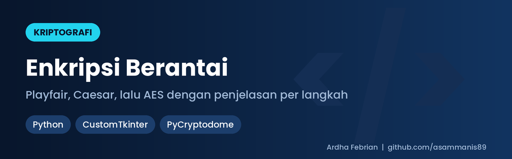
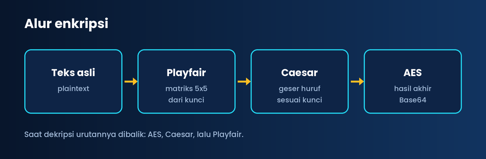

# Enkripsi Berantai – Playfair, Caesar, dan AES (GUI Python)

Aplikasi desktop (Python + CustomTkinter) yang mendemonstrasikan **enkripsi berantai**: teks diproses melalui **Playfair → Caesar → AES**, dengan penjelasan langkah demi langkah untuk setiap tahap. Dikembangkan sebagai tugas kelompok mata kuliah kriptografi.


*Alur enkripsi berantai*

## Fitur

- Tiga lapis cipher berurutan: **Playfair**, **Caesar**, dan **AES** (PyCryptodome).
- Mode **enkripsi dan dekripsi** dengan urutan langkah dibalik saat dekripsi.
- Panel penjelasan per langkah (input, kunci, output).
- Antarmuka modern dengan CustomTkinter.

## File

| File | Isi |
|---|---|
| `3LENGKAP.py` | Versi lengkap tiga cipher berantai |
| `3chiper.py` | Varian tiga cipher |
| `2klasik.py`, `2klasiktest.py` | Dua cipher klasik (Playfair + Caesar) |

## Cara menjalankan

```bash
pip install customtkinter pycryptodome
python 3LENGKAP.py
```

## Catatan

Proyek ini untuk **pembelajaran**. Mode AES yang dipakai adalah ECB, yang tidak disarankan untuk produksi karena pola data terlihat. Untuk aplikasi nyata gunakan AES-GCM atau CBC dengan IV acak.

---

Dibuat oleh Ardha Febrian. Portofolio dan kontak: [asammanis89.github.io](https://asammanis89.github.io), WhatsApp [0857-5517-1491](https://wa.me/6285755171491).
